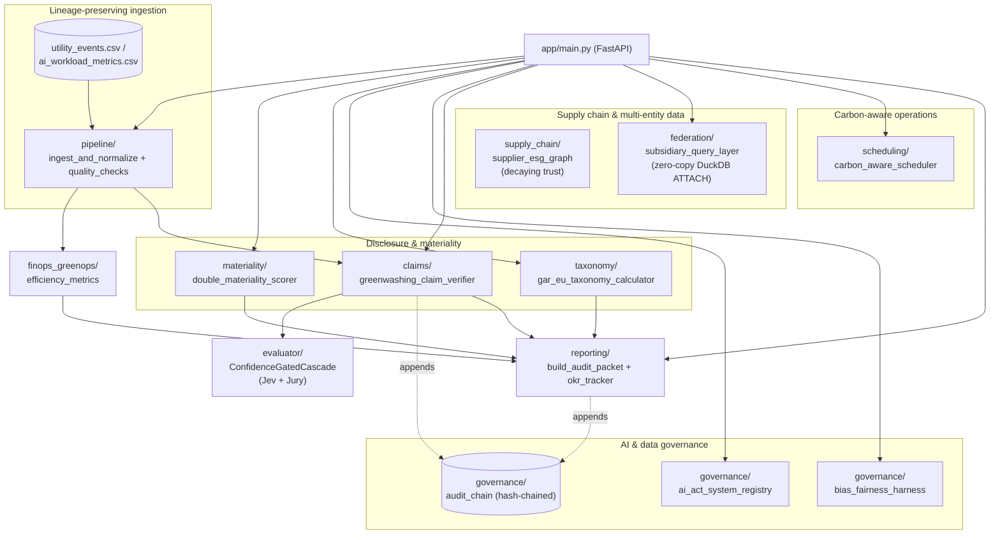
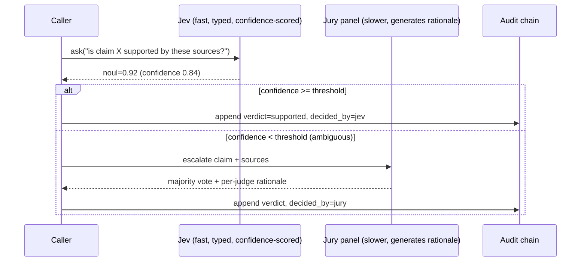

# ESG AI Control Plane

A runnable demonstration that **ESG reporting is an engineering discipline**,
not a once-a-year narrative exercise: every module here preserves source
lineage, surfaces data-quality and governance issues explicitly, and never
silently fabricates a number. Lineage, FinOps/GreenOps telemetry, and AI
governance are solved inside the systems that run the business -- the same
systems this repository is a small, runnable model of.

## Why this exists

The case for treating ESG as engineering, not narrative, rests on evidence
that is already public:

- **ESG performance correlates with financial performance.** IFC research
  tracking 656 investments from 2010-2015 found companies with stronger
  environmental and social performance outperformed weaker peers by roughly
  210 basis points on return on equity and 110 basis points on return on
  assets; a related IFC study linked stronger corporate governance at the
  time of investment to nearly 1.5 points of better average credit risk over
  the investment's life.
- **Governance and data failures are expensive, not abstract.** BP's
  Deepwater Horizon spill triggered a US$53.8 billion pre-tax charge after a
  US commission found systemic cost-cutting had compromised safety controls.
  Volkswagen's emissions-test manipulation cost it EUR 27.4 billion.
  Wirecard collapsed into insolvency over a EUR 1.9 billion accounting hole.
  None of these were sustainability-narrative failures -- they were control,
  data, and governance failures that happened to sit inside the E, S, and G
  buckets.
- **Regulation is converging on financial-grade rigor.** The EU Taxonomy
  Regulation requires banks to classify counterparty exposures against a
  shared green taxonomy (the Green Asset Ratio, module 3 below); the EU AI
  Act requires real governance of AI systems -- inventories, risk tiers,
  human oversight -- not a policy PDF (module 4); ISSB (IFRS S1/S2) pushes
  disclosures toward traceable methodology and source data, closer to
  financial reporting than a sustainability narrative.
- **AI has its own footprint, which the same control plane should track.**
  Data center electricity use is projected to roughly triple between 2023
  and 2030, with AI responsible for around 90% of that growth -- a genuine
  Jevons-paradox risk where AI-driven efficiency gains elsewhere are more
  than offset by the compute footprint of the AI itself (module 10 is a
  direct response to this).

This repository is a small, fully offline, test-covered model of a control
plane built around that thesis -- not a production system, and not a
replacement for real sustainability-reporting software. See
[Honest limitations](#honest-limitations) for exactly what is (and isn't)
real here.

## Table of contents

- [Architecture](#architecture)
- [The 11 modules, and why each exists](#the-11-modules-and-why-each-exists)
- [Evaluator: confidence-gated Jev + jury cascade](#evaluator-confidence-gated-jev--jury-cascade)
- [Quickstart](#quickstart)
- [Demo script](#demo-script)
- [Testing](#testing)
- [Deployment](#deployment)
- [Honest limitations](#honest-limitations)
- [License](#license)

## Architecture



## The 11 modules, and why each exists

| Module | Real-world failure mode / regulation it addresses |
|---|---|
| `pipeline/ingest_and_normalize.py` + `quality_checks.py` | Heterogeneous utility/energy data (mixed units, missing owners, unmapped regions) silently producing wrong numbers instead of visible `issues`. |
| `finops_greenops/efficiency_metrics.py` | Cloud/AI spend and carbon footprint tracked separately, hiding carbon-per-dollar and carbon-per-compute-unit tradeoffs (the Jevons-paradox risk above). |
| `materiality/double_materiality_scorer.py` | GRI/ISSB/CSRD-style double materiality: a topic can matter to the world, to the financials, both, or neither -- reports that skip this ranking either drown in irrelevant metrics or omit material ones. |
| `taxonomy/gar_eu_taxonomy_calculator.py` | The EU Taxonomy's Green Asset Ratio -- a real disclosure metric banks must compute across potentially tens of thousands of counterparty exposures, with full traceability. |
| `governance/ai_act_system_registry.py` | The EU AI Act's requirement for a real system inventory, risk tiering, and human-oversight sign-off -- not a policy document. |
| `governance/bias_fairness_harness.py` | ESG-adjacent scoring/screening models encoding bias even with no explicit group input -- modeled here on the well-documented pattern of naive ESG screens penalizing hard-to-abate sectors (steel, cement, aviation) by absolute emissions alone. |
| `claims/greenwashing_claim_verifier.py` | Generative drafting inventing or overstating a sustainability claim -- every claim is checked against lineage-backed source records before it's allowed to stand. |
| `supply_chain/supplier_esg_graph.py` | Supplier self-attestations treated as permanently reliable -- trust here decays over time since last re-verification, the same spaced-repetition-style decay used for knowledge-graph memory in a sibling project. |
| `federation/subsidiary_query_layer.py` | Group-wide ESG reporting usually means copying every subsidiary's raw data into one warehouse -- this answers cross-subsidiary questions via query pushdown instead, without ever centralizing raw rows. |
| `scheduling/carbon_aware_scheduler.py` | Batch/training jobs scheduled without regard to grid carbon intensity, even though the same job run at a different hour or region can have a very different footprint. |
| `reporting/build_audit_packet.py` + `okr_tracker.py` | Turning everything above into one lineage-backed, tamper-evident export, and tracking ESG objectives as measurable key results instead of vague aspirations. |

`governance/audit_chain.py` is the shared trust mechanism: a hash-chained,
append-only log used by the claim verifier and the audit-packet builder (and
directly reusable by anything else in this repo), following the same
tamper-evidence pattern used across sibling repos in this account
(`graphrag-selective-forgetting`, `enterprise-llm-gateway-router`,
`telemetry-rca-agentic-runtime`).

## Evaluator: confidence-gated Jev + jury cascade

The greenwashing claim verifier (and anything else that needs an automated
"is this supported?" judgment) uses a two-stage cascade instead of a single
LLM-as-judge call:



1. **[Jev](https://typesafe.ai/)** (TypeSafe AI's "System One" model) is
   asked first. It answers typed questions (`noul`/`choice`/`score`) with a
   calibrated confidence score instead of generated text -- see
   [the Jev introduction](https://docs.typesafe.ai/introduction) and
   [how confidence is calculated](https://docs.typesafe.ai/confidence). If
   confidence clears a threshold, the cascade acts on Jev's answer
   automatically -- this is TypeSafe's own documented
   [confidence-gated-routing pattern](https://docs.typesafe.ai/patterns/confidence-routing).
2. If Jev's confidence is too low (ambiguous) or the claim is marked
   high-stakes, the cascade escalates to a small **jury panel**
   (`evaluator/jury.py`) of independent judges that each vote with a
   plain-language rationale -- useful exactly where Jev is weakest: open-ended
   judgment calls that benefit from an explanation, not just a probability.
   DeepEval's [`JevEval`](https://deepeval.com/blog/introducing-jev-as-a-judge)
   blog post describes the same underlying idea (typed questions -> fixed-math
   scoring) for a similar reason.

**Two implementations, same contract.** `evaluator/jev_gate.py` defines the
Jev request/response contract (including TypeSafe's published confidence
formulas, reproduced and unit-tested against their documented examples) and
ships two clients against it:

- `TypeSafeJevClient` -- a real `httpx` adapter for the live
  `POST https://api.typesafe.ai/v1/systemone` endpoint, active only when
  `TYPESAFE_API_KEY` is set.
- `LocalJevStandIn` -- a deterministic, fully offline stand-in implementing
  the *identical* contract and confidence math with simple, explainable
  heuristics (token overlap, deterministic hashing). **This is not the real
  trained Jev model** and makes no claim to match its judgment quality -- it
  exists so this repository runs, tests, and demos deterministically with no
  API key, while staying a one-environment-variable swap away from the real
  model.

No benchmark numbers from TypeSafe's own marketing are repeated here beyond
what's cited above, and none are fabricated.

## Quickstart

```bash
python -m venv .venv
source .venv/bin/activate  # or .venv\Scripts\activate on Windows
pip install -r requirements.txt -r requirements-dev.txt

# Run the test suite (fully offline, no API keys required).
pytest -q

# Run the app directly.
uvicorn app.main:app --reload

# --- OR, with Docker Compose ---
docker compose up --build
```

The app listens on `http://localhost:8000`. Interactive API docs are at
`http://localhost:8000/docs`.

## Demo script

This reproduces the full ingest -> quality-check -> claim-verification ->
audit-packet flow described above, plus the zero-copy federation query.

```bash
# 1. Ingest the bundled sample utility events -- note the explicit quality
#    flags on rows with a missing owner or an unmapped region.
curl -s -X POST http://localhost:8000/ingest | jq '.[] | {event_id, issues}'

# 2. Verify a sustainability claim against those same governed records.
#    Try a claim that IS grounded in the sample data...
curl -s -X POST http://localhost:8000/claims/verify \
  -H "Content-Type: application/json" \
  -d "{\"claim\": \"Our plant-de-01 facility reported energy usage in January 2026.\", \"sources\": $(curl -s -X POST http://localhost:8000/ingest)}" \
  | jq '{verdict, decided_by, confidence, rationale}'

# ...and one that ISN'T, to see the verifier disagree:
curl -s -X POST http://localhost:8000/claims/verify \
  -H "Content-Type: application/json" \
  -d "{\"claim\": \"We achieved full carbon neutrality across every facility in 2026.\", \"sources\": $(curl -s -X POST http://localhost:8000/ingest)}" \
  | jq '{verdict, decided_by, confidence, rationale}'

# 3. Confirm the audit chain is intact (every claim verification appended to it).
curl -s http://localhost:8000/audit/verify | jq

# 4. Query across the two simulated subsidiary DuckDB files -- a zero-copy,
#    aggregate-only cross-entity query; no row ever leaves its subsidiary's
#    own file.
curl -s http://localhost:8000/federation/global-totals | jq

# 5. Ask the carbon-aware scheduler to pick the lowest-carbon feasible window
#    for a 2-hour job that could run in France or Germany.
curl -s -X POST http://localhost:8000/scheduling/find-window \
  -H "Content-Type: application/json" \
  -d '{
        "job": {"job_id": "demo-job", "duration_hours": 2, "expected_kwh_per_hour": 10,
                 "eligible_regions": ["EU-FR", "EU-DE"], "earliest_start_hour": 0, "deadline_hour": 4},
        "forecast_points": [
          {"region": "EU-FR", "hour": 0, "kg_co2e_per_kwh": 0.05},
          {"region": "EU-FR", "hour": 1, "kg_co2e_per_kwh": 0.05},
          {"region": "EU-DE", "hour": 0, "kg_co2e_per_kwh": 0.38},
          {"region": "EU-DE", "hour": 1, "kg_co2e_per_kwh": 0.38}
        ]
      }' | jq
# -> picks EU-FR (France's nuclear-heavy grid is far lower-carbon than Germany's).
```

Run `pytest -q -k test_app` for the equivalent assertions without needing
`curl`/`jq` installed.

## Testing

```bash
pytest -q          # 94 tests, fully offline, deterministic by default
ruff check .        # lint
```

Every module has its own focused test file under `tests/`; `tests/test_app.py`
covers the FastAPI layer end to end, including the claim-verification +
audit-chain-integrity flow and the federation layer's aggregate-only
contract.

## Deployment

- `deployment/azure/main.bicep` + [`docs/AZURE_DEPLOYMENT.md`](docs/AZURE_DEPLOYMENT.md) -- Azure Container Apps, Key Vault, Log Analytics.
- `deployment/gcp/main.tf` + [`docs/GCP_DEPLOYMENT.md`](docs/GCP_DEPLOYMENT.md) -- Cloud Run v2, Secret Manager.

Both are **reference templates that have not been applied to a live cloud
account** as part of building this repository -- see each doc's own status
note and the limitations below.

## Honest limitations

- **No real cloud resources were provisioned.** The Azure/GCP IaC above is
  written to be deployable and was checked by inspection, but `az`/`terraform`
  were not available in the environment that built this repo, so neither
  template was actually applied.
- **`TypeSafeJevClient` is implemented against the real, documented API but
  was never exercised against a live key** -- `TYPESAFE_API_KEY` was not
  available while building this repo. Every test and the default demo path
  use `LocalJevStandIn`, which is explicitly *not* a claim to replicate the
  real model's judgment quality.
- **The jury panel's judges are deterministic, offline heuristics**
  (keyword overlap, numeric consistency), not real LLM calls -- the
  `Judge` protocol is designed so real model-backed judges could be swapped
  in without changing the cascade logic.
- **Bias/fairness and supplier-trust data are synthetic**, constructed to
  exercise the harness's logic (including the "hard-to-abate sector"
  scenario), not drawn from any real company's data.
- **Carbon-intensity and electricity-price figures in `pipeline/quality_checks.py`
  are illustrative, static lookup values**, roughly in line with published
  regional grid-mix averages -- not a live emissions-factor feed.
- **Docker/Docker Compose were not installed** in the environment that built
  this repo; `docker-compose.yml` was validated by parsing it as YAML, not
  by actually running `docker compose up`.
- **The zero-copy federation layer is a local DuckDB `ATTACH` functional
  analog** of the pattern, not a live cross-cloud/cross-tenant deployment.

## License

MIT -- see [LICENSE](LICENSE).
